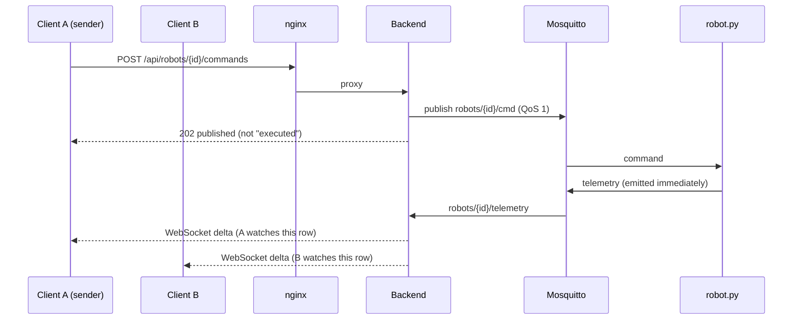

# Robot Console

Live dashboard for MQTT robots: Mosquitto, a Python (FastAPI)
bridge, and a React + TypeScript web client. Operators see every robot's live
state and send commands; when one operator sends a command, the robot changes
state and **every** open client sees it within tens of milliseconds.

The production design (Part 1) is in [docs/DESIGN.md](docs/DESIGN.md).

## Quick start

Requirements: Docker Engine with Compose v2.24+ and `make` on Linux. Nothing
else is installed on the host; every dependency is pinned and resolved inside
the images.

| What | Command |
|---|---|
| Build and run everything | `make up` (or `docker compose up --build`) |
| Open the dashboard | http://localhost:8080 |
| Debug the backend | `make debug`, then attach to `127.0.0.1:5678` |
| Run all tests | `make test` |
| Throughput benchmark | `make load` |
| Stop | `make down` (`make clean` also deletes the generated secrets) |

`make up` starts the broker, the backend, nginx with the web client, and 3
replicas of the provided `robot.py` (unmodified). More robots, either way:

```sh
ROBOTS=10 make up                                    # more robot containers
python3 robot/robot.py --broker tcp://localhost:1883  # from the host (needs paho-mqtt<2)
```

Ports are bound to `127.0.0.1` only: 8080 (UI) and 1883 (MQTT, so robots can be
started on the host). The backend port is not published.

**Authentication** is off by default for local use. To turn it on:

```sh
AUTH_TOKEN_FILE=/run/robot-console-secrets/api.token make up
make token        # prints the generated token; paste it into the UI
```

The test suite always runs with authentication on.

**Debugging the backend.** `make debug` starts the same stack, but the backend
runs under debugpy (debug image only, never in the runtime image) and listens on
`127.0.0.1:5678`, with `LOG_LEVEL=DEBUG`. Your local `backend/app` is mounted
into the container, so breakpoints match the files you edit; after a code change
run `docker compose -p robot-console restart backend`. In VS Code, start the debug
configuration "Backend: attach (make debug)" (`.vscode/launch.json`). Any client
that speaks the Debug Adapter Protocol works the same way. `make up` returns to
the normal image. The debug port allows code execution, so it is bound to
localhost and meant for developer machines only.

### Backend configuration

All settings are environment variables, read and validated once at startup
(`backend/app/config/settings.py`); an invalid value stops the service with a
clear message. Secrets also accept a `NAME_FILE` path (Docker secrets); the
file wins and its content is never logged.

| Variable | Default | Meaning |
|---|---|---|
| `MQTT_HOST`, `MQTT_PORT` | `localhost`, `1883` | Broker address |
| `MQTT_USERNAME`, `MQTT_PASSWORD(_FILE)` | unset | Broker credentials (compose sets the `backend` user) |
| `MQTT_TLS`, `MQTT_CA_FILE` | off, unset | TLS to the broker |
| `AUTH_TOKEN(_FILE)` | unset (auth off) | Shared token for REST and WebSocket |
| `ALLOWED_ORIGINS` | empty | Extra browser origins for `/ws` (same origin is always allowed) |
| `CMD_RATE_GLOBAL`, `CMD_RATE_ROBOT` | `200`, `10` | Commands per second: whole service, per robot |
| `OFFLINE_AFTER`, `FORGET_AFTER` | `6`, `600` | Seconds of silence until offline; until forgotten |
| `FLUSH_INTERVAL`, `DRAIN_INTERVAL` | `0.05`, `0.02` | Push batching; inbox drain period (seconds) |
| `MAX_ROBOTS`, `MAX_WATCH`, `INBOX_MAX` | `200000`, `400`, `200000` | Capacity guards |
| `SEND_TIMEOUT` | `5` | A WebSocket client that cannot take a frame this long is dropped |
| `LOG_LEVEL` | `INFO` | `DEBUG` under `make debug` |
| `DISABLE_DOCS` | off | Hide `/api/docs` and `/api/openapi.json` |

## What is in the box

```
broker/      Mosquitto config + ACL, secret generator (init container)
backend/     FastAPI: MQTT ingest, in-memory state, WebSocket hub, REST commands
frontend/    React + TS (Vite), own windowing, external store; nginx config
robot/       robot.py as provided (unmodified) + its image (paho-mqtt 1.6.1)
tests/       integration tests (run in compose against the real stack)
tools/       robot_sim.py (many robots per connection), loadtest.py
docs/        DESIGN.md: production design on AWS and scale strategy
```

### Code structure

Both apps are layered, with one class, service or component per file. Dependencies
point inward: routes and components call services, services depend on ports
(interfaces), and only the composition root (`config/container/container.py`) knows concrete classes.

```
backend/app/
  main.py              entry point only: create_app() calls AppFactory
  config/              everything that configures and starts the app, one class per file
    app_factory.py     AppFactory: builds the FastAPI app from the pieces below
    settings.py        Settings: all runtime configuration
    environment/       Environment: typed env reads, *_FILE secrets
    container/         Container: the composition root, the only place that knows concrete classes
    lifecycle/         LifecycleManager: startup and shutdown (MQTT, background loops)
    router/            RouterManager: one registry of prefix, tags and auth per router
    error_handling/    ErrorHandlerManager: business error to HTTP status, in one place
    logging/           LoggingConfig
    mqtt/              MqttManager: the broker connection (implements the broker interfaces)
  protocols/           RobotProtocol: modes, commands, id rules, topics (defined once)
  models/              entities/ (Robot, TelemetrySample), requests/ and responses/ (DTOs)
  exceptions/          AppError and one file per business error
  interfaces/          abstractions (typing.Protocol): TelemetrySource, CommandPublisher, MessageBroker
  repositories/        RobotRegistry plus RobotCounters (O(1) summary) and ChangeTracker
  routers/             thin controllers (health, server_config, robots incl. commands, live);
                       dependencies/ (ContainerDep, require_auth), one per file
  services/            CommandService, RobotQueryService, TelemetryParser, TelemetryIngestor,
                       TaskSupervisor, AuditLog
  features/            capabilities with several parts
    realtime/          Hub, ClientSession, ClientWriter, FlushLoop, SummaryBuilder, FrameEncoder,
                       LiveSessionHandler (WebSocket handshake)
    security/          TokenAuth, OriginPolicy, TokenBucket, CommandLimiter
    observability/     Metrics, PrometheusExporter, ProcessStats
  utils/               JsonUtils, RequestUtils (shared helpers, grouped in classes)
backend/tests/         unit/<folder>/ mirrors app/, api/ for HTTP and WebSocket tests, support/ for fakes

frontend/src/
  main.tsx               entry only
  styles/                CSS split by concern, imported in cascade order from index.css
  app/                   the whole application
    App.tsx              root component: boot, auth gate, picks the page
    pages/               one folder per page; a page composes features (dashboard/DashboardPage)
    layout/              page chrome shared by all pages (AppHeader)
    hooks/, providers/   wiring hooks (store, live connection, session) and the store provider
    core/                app-wide singletons, created once
      config/            constants (timeouts, row heights, storage keys, backoff)
      http/              HttpClient, ApiError, the shared client and its interceptor registration
      http/interceptors/ auth header, error-to-message mapping, 401 sign-out
      auth/              token storage (memory, mirrored to sessionStorage)
      api/               one module per backend endpoint (auth, commands, config)
      realtime/          live connection (reconnect, stale detection), frame parser, backoff
      store/             RobotStore facade over RobotIndex, WatchSet, PendingCommands, Notifier; hooks
    shared/              stateless building blocks
      models/            wire protocol and UI types, one per file
      lib/               pure logic (command confirmation rules)
    features/            auth, connection, summary, robots: components, hooks, utils per feature
```

The frontend dependency direction is enforced by ESLint (`eslint.config.js`,
`import-x/no-restricted-paths`), and lint runs first in `make test`:
`shared <- core <- features <- app shell` (all under `src/app/`). Inside `core/` the direction is
`config <- auth <- http <- api`, with `realtime` and `store` beside `api` (the
store does no I/O). Features never import each other, pages never import each other, and barrel files
(`export *`) are rejected (they hurt Vite tree shaking). The React hooks rules
run too.

All HTTP errors go through the interceptor chain in `core/http/interceptors/`: components never inspect
status codes, they show `ApiError.message`. A 401 anywhere signs the user out
through one registered handler.

## How it works



1. **The robot is the source of truth.** The UI never applies a change on its
   own. A button press shows a pending state ("Waiting for robot") until the
   robot's own telemetry confirms it, or "not confirmed" after 6 s.
2. **Commands over REST, live data over WebSocket.** REST makes commands easy to
   authenticate per request, validate (allowlist), rate limit (global and per
   robot), and audit (one JSON line per attempt, accepted or denied). The
   WebSocket is read-only push. `202` means published to the broker, not
   executed; robot.py has no ack channel.
3. **Ingest is batched.** paho's network thread only appends to a bounded deque
   (oldest dropped first: a newer sample supersedes it). An asyncio task drains
   it in batches every 20 ms. Robot counters are maintained incrementally, so
   the summary is O(1) regardless of the robot count, and offline detection touches
   only robots that changed state.
4. **Clients subscribe to what they see.** The client sends
   `{"t":"view","ids":[...]}` for the rows in its viewport. The server sends the
   id index (full, then diffs), deltas only for watched ids, and a 1 Hz summary.
   Per-client traffic is bounded by the viewport, not the robot count: at 50,000
   robots a client receives about 34 KiB/s. Each client's pending work is a set
   (latest wins), so a slow client cannot cause unbounded buffering; one that
   stalls for 5 s is dropped and reconnects.
5. **Leading-edge throttled flush.** The first change after a quiet period is
   pushed immediately; under load there is at most one push per 50 ms.
6. **Offline by staleness.** robot.py has no Last Will, so a robot silent for 6 s
   is shown offline (commands disabled, `409` from the API) and forgotten after
   10 minutes.

### Wire protocol (`/ws`)

| Direction | Frame |
|---|---|
| client to server | `{"t":"auth","token":"..."}` (first frame, only when auth is on) |
| client to server | `{"t":"view","ids":["r-1","r-2"]}` (replaces the watch list, max 400) |
| server to client | `{"t":"hello","modes":[...],"max_watch":400}` |
| server to client | `{"t":"index","full":true,"ids":[...]}` then `{"t":"index","add":[...],"rm":[...]}` (idempotent set operations) |
| server to client | `{"t":"delta","robots":[{"id","battery","charge","mode","online","ts"}]}` |
| server to client | `{"t":"summary","total","online","offline","modes":{...},"avg_battery",...}` every second |

Close codes: `4401` bad token (the client stops retrying and asks for a token),
`4403` origin not allowed.

### Frontend

- External store read through `useSyncExternalStore` with **per-row
  subscriptions**: a delta for robot X re-renders only X's row. Notifications are
  batched per animation frame; snapshots are immutable and reference-stable.
- **Own fixed-height windowing** (no table library): only visible rows plus a
  small overscan are mounted, and only those ids are watched on the server.
  Phones get stacked rows with a different fixed height.
- Reconnect with exponential backoff and **full jitter**, **stale link
  detection** (no frame for 5 s marks the link stale, 10 s replaces it), the
  viewport is re-sent after every reconnect, and the browser `online` event
  triggers an immediate retry.
- Optional token gate driven by `/api/config`. Token kept in `sessionStorage`.
- Runtime dependencies: `react` and `react-dom` only. No external fonts or CDNs.
  Strict CSP (`default-src 'self'`) with zero console violations.

## Security (local prototype)

| Concern | What the prototype does |
|---|---|
| Broker access | Robots connect anonymously (robot.py cannot authenticate). The ACL lets anonymous clients only publish telemetry and read commands: **an anonymous client cannot command a robot or read other robots' telemetry** (verified with a hostile client). The backend authenticates as `backend` with a generated password (PBKDF2 hashed file). Claiming `backend` without the password is refused (verified). |
| Secrets | Generated at first start by an init container into a Docker volume (`broker/init-secrets.sh`), file mode 0400/0600, owned by the consuming uid. Nothing secret in the repo, images or compose file. Services read `*_FILE` paths. |
| API | Optional bearer token (constant-time compare), command allowlist (pydantic, `extra=forbid`), id pattern, robot must be known and online, token-bucket limits (200/s global, 10/s per robot), nginx per-IP limit, 4 KiB body limit, JSON content type required (blocks cross-site form posts), audit log. |
| WebSocket | Origin check (cross-site WebSocket hijacking), auth as first message (never in the URL), 64 KiB max inbound frame, watch list capped. |
| Web | CSP, `X-Frame-Options: DENY`, `nosniff`, `Referrer-Policy: no-referrer`, `Permissions-Policy`, COOP/CORP. HSTS belongs on the TLS terminator in production and is not sent on plain-HTTP localhost. |
| Containers | All non-root, read-only root filesystem, `cap_drop: ALL`, `no-new-privileges`, healthchecks, log rotation, pinned base images. Configs are baked into images (no host bind mounts). |

Production replaces anonymous MQTT with per-device X.509 identities and
thing-scoped IoT policies, and the shared token with OIDC + RBAC (see
DESIGN.md, section 3).

## Tests

`make test` runs everything in containers, with one command:

| Suite | What it covers | Count |
|---|---|---|
| Backend unit (pytest) | RobotRegistry: counters vs a brute-force oracle under random traffic, offline sweep, back online, forget, index diffs (including add/forget in one window), invalid input, capacity guard. Hub: viewport filtering, coalescing (latest wins), full index then diffs, slow client dropped without blocking others and with bounded pending, leading-edge flush. API: auth, every non-public route requires the token, WebSocket auth and origin, allowlist, content type, 404/409/422/429/503 (no internal error text), docs switch, ingest topic/payload validation. Config: env parsing, secrets from files, validation, defaults in one place. | 68 |
| Frontend lint + unit (ESLint, vitest) | Lint: folder boundaries, no barrels, no import cycles, React hooks rules. Store: index full/diffs/idempotence/large diffs, filter, watched-only retention and eviction, per-row notifications, rAF batching, reference-stable snapshots, pending lifecycle (no optimistic state, confirm before 202, timeout, failure, stays watched while pending). Connection: auth first, view after hello, reconnect with backoff, stale detection, 4401 stops retries, garbage frames. Backoff jitter, confirmation rules. | 47 |
| Integration (pytest, real stack) | Real `robot.py` containers, Mosquitto, backend, nginx, auth on. Two WebSocket clients watch a robot; a command is sent via REST; **both** clients must observe the robot report the new state; latency is printed. Run directly against the backend **and through nginx**, for `set_mode` and `toggle_charge`. Also: 401 without/with wrong token, WebSocket 4401, cross-origin WebSocket rejected (403) via nginx, security headers, `/metrics` not exposed via nginx, 404/422. | 7 |

Sample integration output (this machine, final run):

```
[backend direct] set_mode=working: both clients saw the robot report it after 21 ms
[backend direct] toggle_charge from discharging: both clients saw it after 57 ms
[through nginx] set_mode=error: both clients saw the robot report it after 96 ms
[through nginx] toggle_charge from charging: both clients saw it after 52 ms
```

Single samples vary with where the command lands in the 50 ms flush window.
Over 12 sequential commands on an idle stack: median 26 ms, maximum 66 ms.

## Performance

`make load` runs `tools/robot_sim.py` (multiprocess, one MQTT connection per
process, same protocol as robot.py including command handling) at 1 Hz per
robot, so the robot count equals msg/s. During each stage 10 WebSocket clients watch
100 robots each, and 10 commands are timed end to end through a WebSocket.

Measured on an Apple M3 Pro (11 cores visible to Docker Desktop on macOS),
simulator, broker and backend on the same machine, backend unconstrained:

| target msg/s | ingested/s | delivered | backend CPU (% of one core) | RSS | WS KiB/s per client | command round trip p50 / p95 |
|---|---|---|---|---|---|---|
| 1,000 | 998 | 100% | 10% | 57 MB | 12 | 65 / 70 ms |
| 5,000 | 5,005 | 100% | 22% | 60 MB | 14 | 61 / 73 ms |
| 20,000 | 19,997 | 100% | 33% | 78 MB | 18 | 61 / 70 ms |
| 50,000 | 50,009 | 100% | 54% | 116 MB | 34 | 59 / 63 ms |

Finding the ceiling (same setup, `make load STAGES=80000,120000`):

| target msg/s | ingested/s | delivered | backend CPU | RSS | command round trip p50 / p95 |
|---|---|---|---|---|---|
| 80,000 | 79,991 | 100% | 80% | 122 MB | 60 / 75 ms |
| 120,000 | 100,573 | **84%** | **101%** (one core, saturated) | 223 MB | **168 / 984 ms** |

One backend process tops out at about **100,000 msg/s** (GIL-bound, one core).
The important lesson from the overload run: the backend's own inbox dropped
**nothing**. The loss happened upstream, in the broker, because paho's network
thread could not read fast enough. So "inbox drops" is not a sufficient alarm;
CPU of the ingest process and the gap between broker publish rate and ingest
rate are. That is why the scale triggers in DESIGN.md use CPU > 60% of one core
(about 50,000 msg/s here) as the signal to split tiers, well before the cliff.

How to read these numbers honestly:

- "Delivered" compares the simulator's send counter with the backend's receive
  counter over the same window; the counters are sampled at slightly different
  instants, which is why raw values range from 100.1% to 100.5%. There were
  zero inbox drops in every stage.
- **Event loop lag** is reported by the backend (`robot_console_event_loop_lag_ms`):
  p50 5 to 11 ms, max 37 ms. An **empty** asyncio loop in the same container
  already overshoots a 20 ms sleep by 7 to 11 ms (Docker Desktop VM timer
  slack, measured separately), so most of that is the host, not the
  application. On native Linux the baseline is expected to be well under 1 ms,
  but I did not measure that.
- Command round trip under load (about 60 ms) is higher than idle (about 26 ms)
  because under constant traffic every change waits for the next 50 ms flush
  slot. That is the intended latency/batching trade-off (`FLUSH_INTERVAL`).
- The simulator multiplexes robots over few connections, so this measures the
  bridge and backend, not Mosquitto's connection scaling (tens of thousands of
  TCP connections). It was not run on Linux bare metal.

## Design choices and why

| Choice | Why | Cost accepted |
|---|---|---|
| Mosquitto | Small, standard, ACLs and password files built in, starts in under a second | Single node, no clustering (fine locally; IoT Core in production) |
| Python + FastAPI + paho | The provided robot is Python; asyncio handles many sockets; measured headroom is ample for the target | Per-core throughput lower than Go; the hot loop can be rewritten behind the same interfaces |
| In-memory state, no database | Nothing to persist for live state; a restart rebuilds it within one telemetry period | No history yet (see below) |
| Web app (not mobile) | One codebase, works on phones (responsive, stacked rows), zero install for evaluators | No push notifications, no offline mode |
| No UI framework or table library | Two runtime dependencies, full control over rendering cost, small bundle (75 KB gzip) | More code to own (windowing, store) |
| Separate images for robot (paho 1.x) and backend (paho 2.x) | robot.py uses the 1.x constructor and must not be modified | Two Python images |

## Trade-offs knowingly skipped

- **History** is not persisted (see "Adding history" below).
- **One shared token** instead of users and roles; no per-operator audit identity.
- **No TLS** locally (localhost only); production terminates TLS at the load balancer.
- **No command correlation**: robot.py does not echo the command id, so
  confirmation is inferred from state (`set_mode` checks the mode, `toggle_charge`
  a flip, `kick` a battery increase of at least 4 points so charging drift is not
  mistaken for it).
- **TypeScript 6.0, not 7**: typescript-eslint (needed for linting) supports
  TypeScript below 6.1 only, so the type checker is pinned to 6.0.3. Revisit
  when typescript-eslint supports TypeScript 7.
- **No backend linter** (ruff, mypy) wired into `make test` yet; the backend
  layering is held by convention and review.
- **Single backend instance**: no HA. Scaling path in DESIGN.md, section 6.
- **Full id index on connect**: fine up to tens of thousands of robots (50,000 ids
  is roughly 600 KB uncompressed), but should become server-side paging beyond that.
- **Sorting and filtering by mode** on the client would need server-side queries,
  because the client only holds data for visible rows. Search by id works on the full index.
- **Index diffs can repeat an id** that the full index already contained, when a
  robot appears just as a client connects. Index operations are idempotent by
  contract, which is cheaper than per-client sequence numbers.
- **Browser end-to-end test**: the integration test drives the same REST and
  WebSocket API the browser uses, not a browser. I checked the UI manually in
  Chromium (two tabs, commands from one appearing in the other, mobile width,
  zero console errors), but that check is not automated.

## Adding history without rebuilding

1. Add a sink at the single ingest point (`Ingestor.process`) that batches valid
   samples into TimescaleDB (a new compose service) through its own bounded
   queue, so the live path never waits on the database.
2. Add `GET /api/robots/{id}/history?from=&to=&step=` with server-side
   downsampling.
3. Add a detail drawer in the client with a battery chart and a mode timeline.

The protocol, the live store and the command path stay unchanged. The
production version (Kinesis to Firehose/S3 plus a hot time-series store) is in
DESIGN.md, section 7.

## Next steps, given another day

1. History (above), behind a feature flag.
2. Playwright end-to-end test of the real UI: two browsers, click, assert.
3. OIDC sign-in and roles; WebSocket ticket instead of a raw token.
4. Propose a protocol change to the robot team: echo `cid` in telemetry, add an
   LWT and a heartbeat; then remove the inference heuristics.
5. Server-side paging and filtering of the index (by mode, battery, online).
6. Run the load test on a Linux host with CPU limits that match the target
   instance size, and add a broker connection-scaling test with real per-robot
   connections.

## What was verified, and what was not

Verified on this machine (macOS, Docker Desktop, Apple M3 Pro):

- `make up` brings the whole stack up healthy from scratch; `make test` passes
  (68 + 47 + 7 tests); `make load` produced the table above.
- The original backend ran against Mosquitto and real robot.py containers; the
  bugs found are listed below with their fixes.
- The broker ACL holds against a hostile anonymous client and a client
  impersonating `backend`.
- UI checked manually in Chromium at desktop and phone width.

Not verified:

- Running on a Linux host. Everything runs in Linux containers, but the host
  was macOS. The compose file uses `!reset`, which needs Compose v2.24+.
- Native-Linux event loop lag baseline; Mosquitto with tens of thousands of
  real connections; Safari and Firefox.

### Issues found in the existing backend and fixed

| Problem | Fix |
|---|---|
| Background tasks (ingest, flush) unsupervised: one exception would freeze the dashboard while `/healthz` stayed green | Supervisor restarts the loop and counts restarts; `/healthz` returns 503 if a task stops |
| Fixed 100 ms flush tick: about 100 ms added to every command round trip (measured 103 ms) | Leading-edge throttled flush, interval 50 ms: about 26 ms idle, about 60 ms under 50k msg/s |
| Slow client dropped by the writer stayed registered in the hub | Unregistered on drop |
| New client waited up to 1 s for the first summary | Latest summary sent on connect |
| No WebSocket Origin check (any website could read the live stream in dev mode) | Same-origin by default, `ALLOWED_ORIGINS` for extras, `4403` |
| Audit log trusted client-supplied `X-Forwarded-For`, and logged only successes | Uses nginx `X-Real-IP`; JSON audit line for every attempt including denials |
| `fastapi==0.162.0` was 2 days old | Pinned to 0.143.0 (published more than two weeks ago); same rule for all pins |
| Module-level `app = create_app()` read the environment at import | `uvicorn --factory`; tests build apps with injected settings and a fake broker |
| Secret file errors produced a raw traceback; settings were not validated | Clear startup errors, value validation |
| Mosquitto warned the ACL file was world readable | 0400, owned by the broker uid |
| No CPU or memory metric | `process_cpu_seconds_total`, `process_resident_memory_bytes` |
