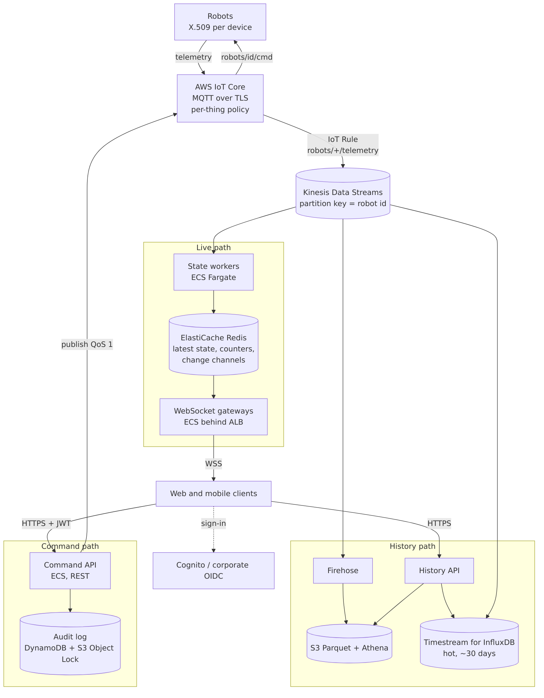
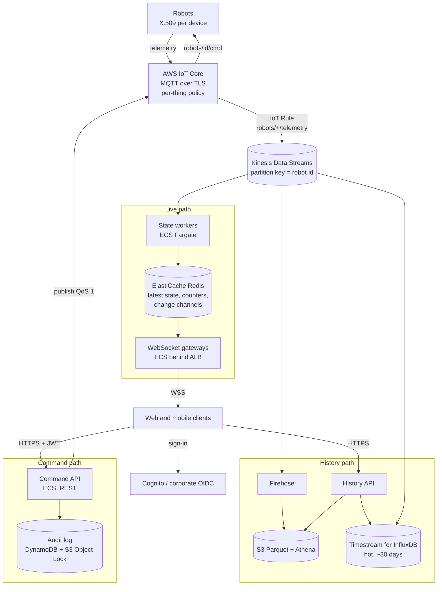

# Robot Console: production design (AWS)

Part 1 of the challenge: sections 1 to 5. Appendices: scale strategy (A), history (B),
prototype mapping (C). Core rule: the robot is the **single source of truth**. A
command never changes state directly; the robot's next telemetry does, and every
client sees that.

## 1. Architecture

Diagram source (Mermaid). Re-render <code>architecture.png</code> / <code>.svg</code> after editing.

- **Ingest.** An IoT Rule forwards telemetry to Kinesis, keyed by robot id (order,
  buffering, 24 h replay); state workers update Redis and publish change notices.
- **Live.** Gateways send a snapshot from Redis, then only deltas for the robots a
  client displays (latest wins) and a 1 Hz summary: traffic scales with the
  viewport. Ingest and gateways scale independently (Appendix A).
- **Commands.** REST `POST /robots/{id}/commands` (easy to authorise, rate-limit,
  audit and retry): token and site scope, allowlist, rate limits, audit record,
  publish to `robots/{id}/cmd` (QoS 1), answer `202`. Telemetry confirms it.
- **History.** Kinesis also feeds Firehose (Parquet on S3, Athena) and Timestream
  for InfluxDB (LiveAnalytics is closed to new customers since June 2025).

## 2. Stack choices and trade-offs

- **IoT Core** over self-hosted EMQX: managed MQTT with per-device X.509 and
  policies; we do not own broker HA or certificate lifecycle.
- **Kinesis** between broker and workers, rather than IoT Rule to Lambda:
  replay after a bug fix, per-robot ordering, no cold starts.
- **Redis** for live state, rather than DynamoDB: sub-millisecond snapshots and
  pub/sub fan-out; durability comes from Kinesis replay.
- **Python on ECS Fargate first:** prototype code, measured at 50,000 msg/s on
  about half a core; the hot loop can move to Go behind the same interfaces.
- **Accepted for v1:** one region (RTO hours); confirmation inferred until robots echo an id.

## 3. Security, end to end

- **Devices and broker ACLs:** X.509 per robot, TLS on 8883, per-device
  revocation. Thing-name policies: a robot only connects as itself and uses its
  own topics; only the Command API's IAM role may publish commands.
- **Operators:** OIDC (Cognito, corporate IdP), MFA, PKCE on mobile, WebSocket
  ticket instead of a URL token; site-scoped roles, deny by default.
- **Commands:** allowlist, per-operator and per-robot rate limits, idempotency
  keys, append-only audit of every attempt (S3 Object Lock).
- **Edge, network, secrets:** TLS everywhere, WAF, CSP, Origin checks, private
  subnets, Secrets Manager with rotation, KMS at rest, GuardDuty, Device Defender.

## 4. Failure modes

- **Silent robot** (no LWT): marked offline after a timeout, commands disabled.
- **Lost command:** `409` if offline; the client shows "not confirmed".
- **Worker or Redis failure:** Kinesis checkpoint and idempotent replay; Multi-AZ
  Redis rebuilds within one telemetry period.
- **Gateway restart, slow client:** jittered reconnect with a fresh snapshot; a
  latest-wins set per client, dropped after a send timeout.
- **Reconnect storm, bad payload:** Kinesis absorbs bursts; schema validation and
  the id from the policy-bound topic.

## 5. Build order

**1. Vertical slice** (IoT Core with certificates, one worker, Redis, one gateway,
Command API, web client) to prove the loop and the security model. **2. Real
auth** (OIDC, site roles, audit). **3. Observability** (ingest rate, iterator age,
command round trip). **4. History** (Firehose to S3 from day one, then the hot
store and charts). **5. Scale and resilience** (load and chaos tests). **6. Mobile
app** on the same APIs.

---

# Appendices

## A. Scale strategy: 100 to 5,000 robots vs 5,000 to 50,000 robots

Measured on the prototype: one Python backend process
ingested 50,000 msg/s (50,000 robots at 1 Hz) at 54% of one core with full
delivery, and saturated at about 100,000 msg/s. At 120,000 msg/s it lost 16% of
messages **in the broker** (not in its own inbox) and command latency p95 rose to
about 1 s. The limits that matter first are therefore availability, fan-out and
the id index on clients; raw ingest becomes the limit near 50,000 robots.

### 100 to 5,000 robots: one service, made highly available

The prototype's shape is enough. What changes, in order:

| Order | Change | Trigger metric |
|---|---|---|
| 1 | Run 2 instances behind the ALB, each subscribing to all telemetry (shared nothing; 5,000 robots is a few MB of state). Sticky sessions not needed. | Any availability requirement (always). |
| 2 | Move latest state to Redis so a restarted instance serves snapshots instantly. | Restart-to-ready time > 1 telemetry period, or more than 2 instances. |
| 3 | Add a third instance per 2,000 to 3,000 concurrent WebSocket clients. | Gateway CPU > 60% sustained, or WebSocket send p99 > 100 ms. |

### 5,000 to 50,000 robots: split the tiers

| Order | Change | Trigger metric |
|---|---|---|
| 1 | Split ingest (state workers on Kinesis shards) from fan-out (gateways). | Ingest CPU > 60% of one core (about 50,000 msg/s measured), or broker publish rate minus ingest rate > 0.5% (the overload test showed losses happen in the broker, invisible to the backend's inbox counter), or event loop lag p99 > 50 ms above idle baseline. In production: Kinesis iterator age > 2 s. |
| 2 | Partition change notifications by robot-id hash; each gateway subscribes only to the partitions its clients watch. | Gateway CPU spent mostly on discarding updates nobody watches (deltas routed / deltas received < 10%). |
| 3 | Replace the full id index with server-side paging and search (client asks for a window and a total). | Full index > 100 KB compressed, or first render on a mid-range phone > 1 s. |
| 4 | Pre-aggregate the summary per shard and merge (sum of counters). | Summary computation visible in gateway CPU profiles. |
| 5 | Rewrite the hot loop (validation and routing) in Go or Rust, behind the same Kinesis-in, Redis-out interface. | See below. |

**Rewrite instead of scaling out when** all of these hold: the component is CPU
bound per message (not I/O bound), its interfaces are stable and covered by
contract tests, and scaling out costs more than the rewrite (as a rule of thumb,
more than about 8 instances of a component that a compiled implementation would
run on 1 or 2). Do not rewrite to fix an architecture problem (for example
broadcasting everything to everyone); fix the fan-out design first. In this
system the likely candidate is the state worker, not the gateway, because the
gateway is dominated by network I/O.

## B. Adding history without rebuilding

The prototype keeps live state only. History is added beside the live path, not
in it:

1. **Tap the existing ingest point.** Every valid sample already passes through
   one function (`Ingestor.process`). Add a sink there (or, in production, a
   second Kinesis consumer) that batches samples into a time-series store
   (TimescaleDB locally, the hot store plus S3 on AWS). The live path does not
   wait on it: the sink has its own bounded buffer and drops or spills under
   pressure.
2. **Add a read API:** `GET /api/robots/{id}/history?from=&to=&step=` returning
   downsampled points (server-side bucketing, so a year of 1 Hz data is still a
   few hundred points).
3. **Add a client view:** a detail drawer with a battery chart and a mode
   timeline. The live table, store and WebSocket protocol stay unchanged.

Nothing that ships today is rebuilt: the protocol, the live store and the
command path stay as they are.

## C. Prototype to production mapping

| Prototype | Production |
|---|---|
| Mosquitto + ACL file | IoT Core + IoT policies, X.509 per device |
| `config/mqtt/mqtt_manager.py` bounded inbox | Kinesis Data Streams |
| `repositories/robot_registry.py` (in memory, O(1) counters) | State workers + Redis |
| `features/realtime/` hub and flush loop (viewport subscriptions, coalescing) | WebSocket gateways |
| `services/command_service.py` (allowlist, rate limit, audit log) | Command API + audit store |
| Static shared token | OIDC + RBAC |
| nginx (headers, proxy) | ALB + WAF + CloudFront |
