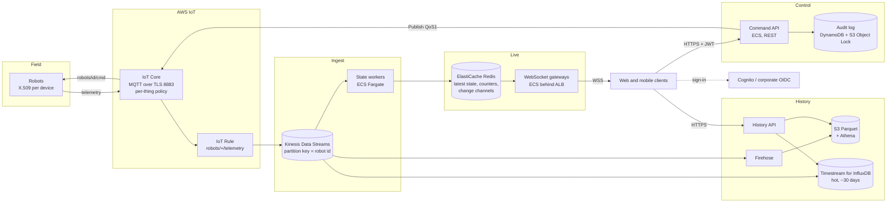

# Robot Console: production design (AWS)

Part 1 of the challenge. The local prototype (Part 2) is a deliberately small
version of this design: every prototype module maps to a production component
(table at the end), so the prototype is a working model of the target, not a
throwaway.

## 1. Requirements that shape the design

| Requirement | Design consequence |
|---|---|
| Live: one operator's command is visible to every client | The robot is the single source of truth. Commands never update state directly; the robot's next telemetry does, and that is fanned out to all clients. |
| A freshly opened client renders instantly | Latest state per robot is kept in a fast store (Redis), served as a snapshot plus a live stream. |
| Web and mobile clients | One transport (WebSocket, JSON) and one REST API for both. Per-client traffic must be bounded (mobile data, battery). |
| Historical telemetry | A separate, append-only path. It must never slow the live path. |
| Non-trivial scale | Robot count and operator count scale independently, so ingest and fan-out are separate tiers. |

## 2. Architecture

**Data path.** Robots publish to IoT Core. One IoT Rule forwards all telemetry
into Kinesis, partitioned by robot id, which preserves per-robot ordering and
buffers bursts (24 h retention, replayable). State workers validate each
sample, update the latest state in Redis (a hash per robot, a sorted set for the
id index, and incremental robot counters), and publish compact change notices on
Redis channels partitioned by robot-id hash.

**Live path.** WebSocket gateways hold client sessions. A client says which
robots it is looking at (the visible rows); the gateway sends a snapshot from
Redis, then only deltas for those robots, coalesced per client ("latest wins"),
plus a 1 Hz robot summary. Per-client traffic is bounded by the viewport, not by
robot count, which is what makes mobile viable.

**Command path.** Clients call `POST /robots/{id}/commands`. The Command API
authenticates the JWT, authorises the operator for that robot's site, validates
the command against an allowlist, rate-limits, writes an audit record, and
publishes to `robots/{id}/cmd` with QoS 1 and a correlation id. It answers
`202 Accepted` (published, not executed). The robot's next telemetry is the
confirmation, and it reaches every client through the live path. Commands use
REST, not the WebSocket, because REST is easy to authorise per request, rate
limit at the edge, audit, retry idempotently (`Idempotency-Key`), and call from
automation.

**History path.** Kinesis also feeds Firehose (Parquet in S3, partitioned by
date and site, queried with Athena for long ranges and analytics) and a hot
time-series store for dashboard queries over recent weeks. Note: AWS stopped
onboarding new customers to Timestream for LiveAnalytics in 2025 as far as I
know, so the hot store here is Timestream for InfluxDB; verify the current
service status before committing. The History API reads hot first, then S3.

### Stack choices

| Choice | Why | Alternative considered |
|---|---|---|
| IoT Core | Managed MQTT with per-device X.509, policies, bulk device provisioning, Device Defender | Self-hosted EMQX: more control, but we would own HA, patching and cert lifecycle |
| Kinesis between IoT and workers | Durable buffer, replay after a bug fix, ordered per robot, decouples ingest speed from broker | IoT Rule straight to Lambda: simpler, but no replay, cold starts, harder ordering |
| Redis for latest state | Sub-millisecond reads for snapshots, pub/sub for change fan-out, atomic counters | DynamoDB: durable but higher read latency and no native fan-out |
| Python workers and gateways first | Same code as the prototype, measured headroom (see README); hot paths can move to Go later behind the same interfaces | Go from day one: faster per core, slower to iterate |
| ECS Fargate | No node management, per-service scaling | EKS: worth it only if the org already runs Kubernetes |

## 3. Security, end to end

- **Device identity and transport.** One X.509 certificate per robot (bulk
  provisioning, private key in a secure element where the hardware allows), TLS
  1.2+ to IoT Core on 8883. Certificates are rotated and can be revoked per
  device.
- **Broker ACLs.** IoT policy with thing-name substitution: a robot may only
  connect with client id `${iot:Connection.Thing.ThingName}`, publish to
  `robots/${thing}/telemetry` and subscribe to `robots/${thing}/cmd`. A
  compromised robot cannot read or command another. Only the Command API's IAM
  role may publish to `robots/+/cmd`. (The prototype enforces the same shape
  with a Mosquitto ACL: anonymous robots cannot publish commands.)
- **Operator authentication.** OIDC (Cognito federated with the corporate IdP),
  MFA, short-lived access tokens (15 min) with refresh. Mobile uses PKCE. The
  WebSocket authenticates with a short-lived ticket obtained over REST, never a
  token in the URL (URLs end up in logs).
- **Authorisation.** RBAC plus scope: viewer, operator, admin, each limited to a
  set of sites. Enforced in the Command API (commands) and in the gateway (which
  robot ids a client may watch). Deny by default.
- **Command safety.** Allowlisted vocabulary and value ranges, per-operator and
  per-robot rate limits, idempotency keys, an audit record for every attempt
  (accepted or denied, who, what, when, from where) in append-only storage
  (S3 Object Lock).
- **Transport and edge.** TLS everywhere (ACM certificates), HSTS, AWS WAF on the
  ALB (rate rules, bot control), strict CSP, Origin check on WebSocket upgrades,
  CORS limited to known origins.
- **Secrets and keys.** Secrets Manager with rotation, KMS encryption for
  Kinesis, S3, Redis (in-transit and at-rest), DynamoDB. Nothing secret in
  images, environment files or code; services read secrets at start via IAM.
- **Network.** Services in private subnets, VPC endpoints for AWS APIs, security
  groups allowing only the required flows. Redis has AUTH and TLS and is not
  reachable from outside the VPC.
- **Detection.** CloudTrail, GuardDuty, IoT Device Defender (unusual message
  rates, auth failures), alarms on command spikes and auth failures.
- **Supply chain.** Pinned dependencies and base images, image scanning (ECR),
  SBOM, signed images, non-root read-only containers (as in the prototype).

## 4. Failure modes considered

| Failure | Effect | Mitigation |
|---|---|---|
| Robot goes silent (no LWT in the protocol) | State looks live but is stale | Staleness timeout marks it offline; UI greys it out and disables commands. A real protocol should add an LWT and a heartbeat. |
| Command lost or robot offline | Operator waits forever | `409` if known offline; client shows "not confirmed" after a timeout; correlation id lets the robot echo the command later (protocol change). |
| State worker crash | Gap in live updates | Kinesis checkpointing: a replacement resumes from the last checkpoint; latest-wins state makes replays idempotent. |
| Redis node failure | Live view degraded | Multi-AZ replication with automatic failover; gateways reconnect; state rebuilds from Kinesis within one telemetry period. |
| Gateway crash or deploy | Clients disconnected | Clients reconnect with exponential backoff and jitter (no thundering herd), resubscribe the viewport, get a fresh snapshot. Connection draining on deploy. |
| Slow client (mobile on poor network) | Server memory growth | Per-client pending set (latest wins) instead of a queue; send timeout drops the client, which then reconnects. |
| Telemetry burst (all robots reconnect at once) | Ingest lag | Kinesis absorbs it; workers scale on iterator age; bounded inboxes drop the oldest sample (newest supersedes). |
| Bad or malicious payload | Crash or poisoned state | Strict schema validation, id taken from the topic (bound by the IoT policy), size limits at the broker; invalid samples counted and dropped. |
| Region outage | Service down | Accepted for v1 (RTO hours). Multi-region active-passive with IoT Core custom domains is a later step. |

## 5. Build order

1. **Thin vertical slice** (the prototype, then on AWS): IoT Core with device
   certs and policies, one state worker, Redis, one gateway, the command API,
   the web client. This proves the full loop and the security model early.
2. **Auth for real:** OIDC, RBAC with site scopes, audit store.
3. **Observability:** metrics (ingest rate, iterator age, loop lag, command
   round trip), traces with the command correlation id, dashboards and alarms.
4. **History:** Firehose to S3 first (cheap, captures everything from day one),
   then the hot store and the History API, then charts in the client.
5. **Scale and resilience:** horizontal gateways, sharded workers, load tests at
   2x the target, chaos tests (kill workers, fail over Redis).
6. **Mobile app** on the same APIs.

## 6. Scale strategy: 100 to 5,000 robots vs 5,000 to 50,000 robots

Measured on the prototype (README, "Performance"): one Python backend process
ingested 50,000 msg/s (50,000 robots at 1 Hz) at 54% of one core with full
delivery, and saturated at about 100,000 msg/s. At 120,000 msg/s it lost 16% of
messages **in the broker** (not in its own inbox) and command latency p95 rose to
about 1 s. The limits that matter first are therefore availability, fan-out and
the id index on clients; raw ingest becomes the limit near 50,000 robots.

### 100 to 5,000 robots: one service, made highly available

The prototype's shape is enough. What changes, in order:

| Order | Change | Trigger metric |
|---|---|---|
| 1 | Run 2 instances behind the ALB, each subscribing to all telemetry (shared nothing; 5,000 robots is a few MB of state). Sticky sessions not needed. | Any availability requirement (always). |
| 2 | Move latest state to Redis so a restarted instance serves snapshots instantly. | Restart-to-ready time > 1 telemetry period, or more than 2 instances. |
| 3 | Add a third instance per 2,000 to 3,000 concurrent WebSocket clients. | Gateway CPU > 60% sustained, or WebSocket send p99 > 100 ms. |

### 5,000 to 50,000 robots: split the tiers

| Order | Change | Trigger metric |
|---|---|---|
| 1 | Split ingest (state workers on Kinesis shards) from fan-out (gateways). | Ingest CPU > 60% of one core (about 50,000 msg/s measured), or broker publish rate minus ingest rate > 0.5% (the overload test showed losses happen in the broker, invisible to the backend's inbox counter), or event loop lag p99 > 50 ms above idle baseline. In production: Kinesis iterator age > 2 s. |
| 2 | Partition change notifications by robot-id hash; each gateway subscribes only to the partitions its clients watch. | Gateway CPU spent mostly on discarding updates nobody watches (deltas routed / deltas received < 10%). |
| 3 | Replace the full id index with server-side paging and search (client asks for a window and a total). | Full index > 100 KB compressed, or first render on a mid-range phone > 1 s. |
| 4 | Pre-aggregate the summary per shard and merge (sum of counters). | Summary computation visible in gateway CPU profiles. |
| 5 | Rewrite the hot loop (validation and routing) in Go or Rust, behind the same Kinesis-in, Redis-out interface. | See below. |

**Rewrite instead of scaling out when** all of these hold: the component is CPU
bound per message (not I/O bound), its interfaces are stable and covered by
contract tests, and scaling out costs more than the rewrite (as a rule of thumb,
more than about 8 instances of a component that a compiled implementation would
run on 1 or 2). Do not rewrite to fix an architecture problem (for example
broadcasting everything to everyone); fix the fan-out design first. In this
system the likely candidate is the state worker, not the gateway, because the
gateway is dominated by network I/O.

## 7. Adding history without rebuilding

The prototype keeps live state only. History is added beside the live path, not
in it:

1. **Tap the existing ingest point.** Every valid sample already passes through
   one function (`Ingestor.process`). Add a sink there (or, in production, a
   second Kinesis consumer) that batches samples into a time-series store
   (TimescaleDB locally, the hot store plus S3 on AWS). The live path does not
   wait on it: the sink has its own bounded buffer and drops or spills under
   pressure.
2. **Add a read API:** `GET /api/robots/{id}/history?from=&to=&step=` returning
   downsampled points (server-side bucketing, so a year of 1 Hz data is still a
   few hundred points).
3. **Add a client view:** a detail drawer with a battery chart and a mode
   timeline. The live table, store and WebSocket protocol stay unchanged.

Nothing that ships today is rebuilt: the protocol, the live store and the
command path stay as they are.

## Prototype to production mapping

| Prototype | Production |
|---|---|
| Mosquitto + ACL file | IoT Core + IoT policies, X.509 per device |
| `config/mqtt/mqtt_manager.py` bounded inbox | Kinesis Data Streams |
| `repositories/robot_registry.py` (in memory, O(1) counters) | State workers + Redis |
| `features/realtime/` hub and flush loop (viewport subscriptions, coalescing) | WebSocket gateways |
| `services/command_service.py` (allowlist, rate limit, audit log) | Command API + audit store |
| Static shared token | OIDC + RBAC |
| nginx (headers, proxy) | ALB + WAF + CloudFront |
